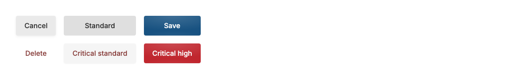
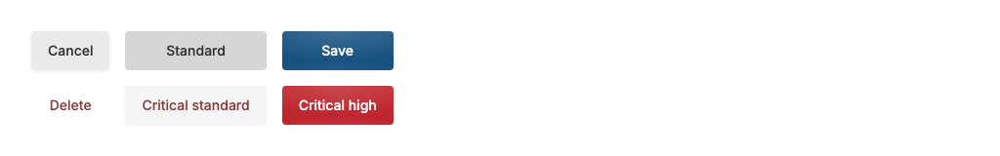
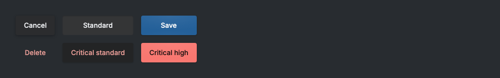
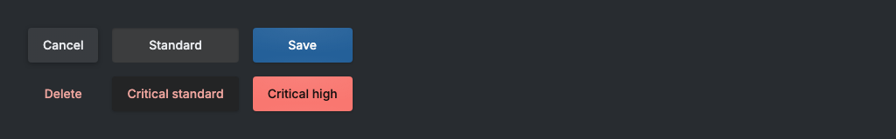
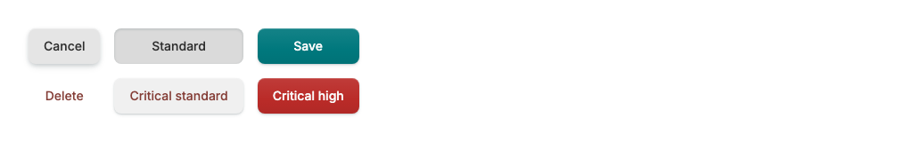
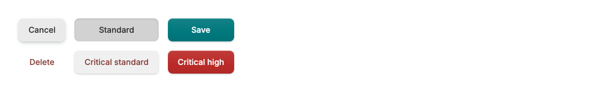
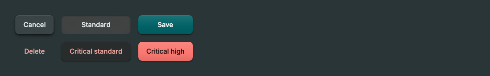

# Adaptive Button state captures (#925)

Each image shows the same low and standard Buttons in hover and pressed states over an app-painted
overlay. `before` was captured from `origin/main` at `4518fa32`; `after` was captured from this
implementation. Captures use the same Chromium visual test harness and 1024 × 800 viewport.

| Theme   | Mode  | Before                                                        | After                                                       |
| ------- | ----- | ------------------------------------------------------------- | ----------------------------------------------------------- |
| Paper   | Light |      |      |
| Paper   | Dark  |        |        |
| Tactile | Light |  |  |
| Tactile | Dark  |    |    |
